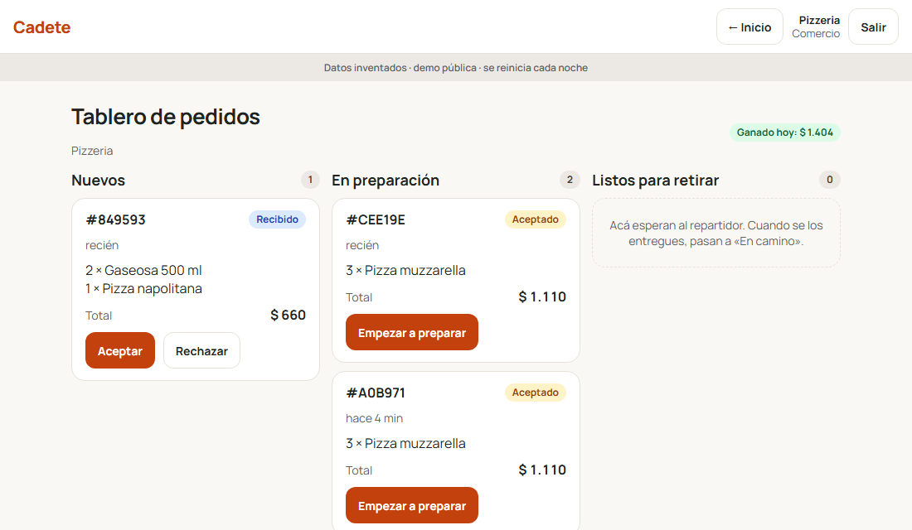
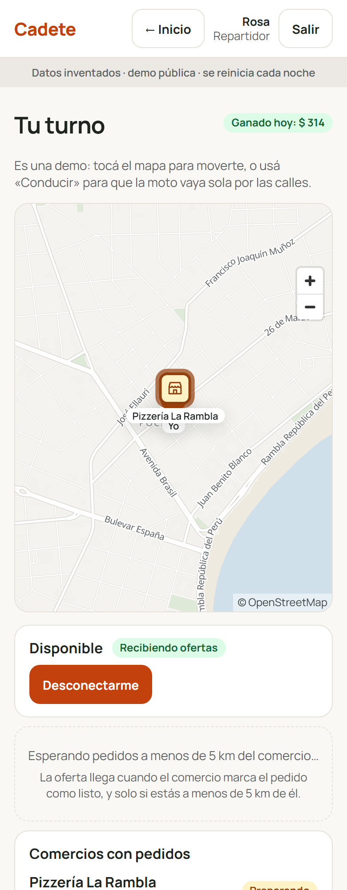
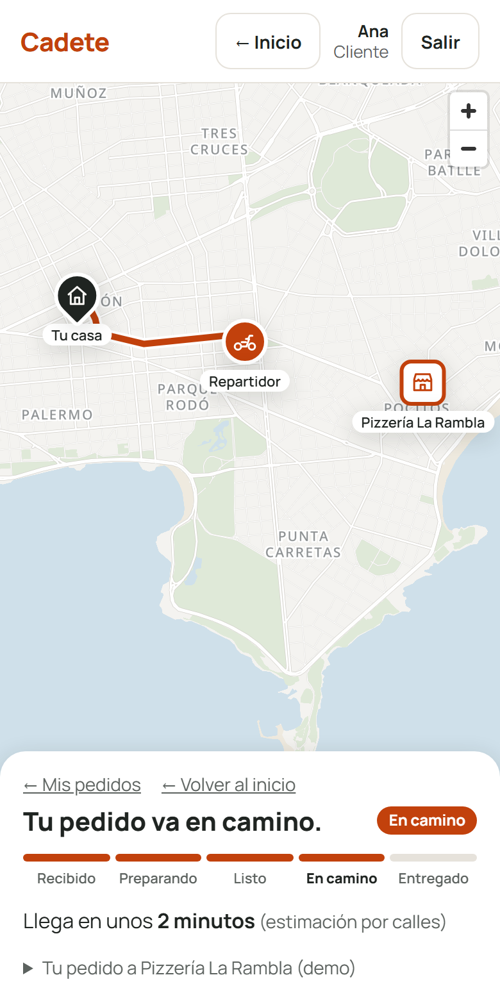
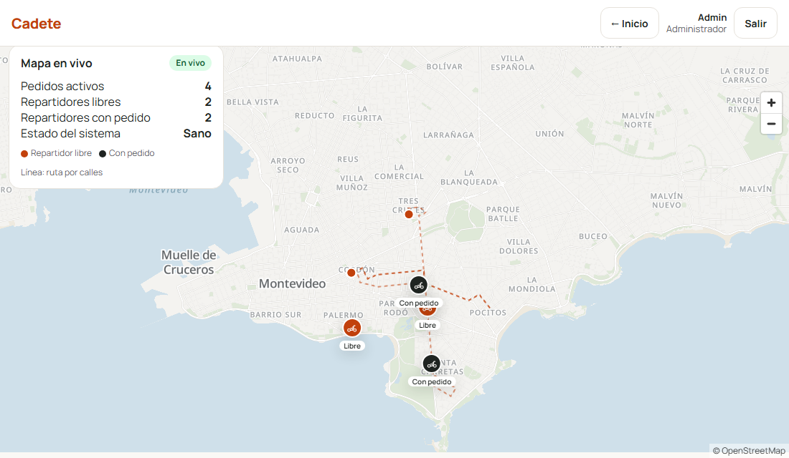

# Cadete

Ordering and delivery platform for Montevideo, Uruguay. A customer orders from a shop, the shop prepares the order, the system dispatches the nearest courier by real street distance, and everyone follows the delivery on a live map of their own.

> **Demo project. All data is made up.** No real money, no real people, no real businesses.

*Cadete* is the River Plate word for "delivery rider". It is a portfolio project built step by step with tests first (396 tests, CI with pytest + gitleaks).

## What it does

1. **Customer** picks a shop and products, types any Montevideo address (or taps the map) and confirms. Confirming twice creates one order (idempotency).
2. **Shop** accepts, prepares and marks the order *ready*. Once the courier picks it up, it leaves the kitchen board and stays under "On its way" so the shop can still follow it (returns).
3. **Courier** sees which shops are preparing orders (pulsing markers). When the shop marks *ready*, the nearest couriers within 5 km get an offer (30 s to answer). Then: *arrived* → *picked up* → *delivered*, each enabled only near the place (150 m, checked on the server).
4. **Money:** on delivery a double-entry ledger records the charge to the customer, 90 % of the products to the shop, a distance-based fee to the courier (trip to the shop included) and the remainder to the platform. All entries sum to zero.
5. **Admin** watches every courier and order live on a map, plus system health.

## Screenshots

| Shop board | Courier sees who is cooking | Customer follows live |
|---|---|---|
|  |  |  |



## Stack

Python 3.12 · FastAPI · SQLAlchemy 2 + Alembic · PostgreSQL 17 + PostGIS + pg_trgm · Redis (pub/sub, positions, rate limits) · Server-Sent Events · OSRM (street routing) · Protomaps PMTiles + MapLibre GL JS (own map, light/dark) · vanilla JS front end · Docker Compose · GitHub Actions · gitleaks.

Highlights worth reading in the code:

- one state machine for orders (`app/services/order_state.py`), row-locked, with full history;
- dispatch with `FOR UPDATE SKIP LOCKED`, offers that expire, and a background worker;
- routing behind an interface, with a straight-line fallback if OSRM is down;
- self-hosted geocoder (311k house numbers, trigram search, interpolation) with no external service;
- structured JSON logs, request ids, Prometheus metrics, worker heartbeats.

## Design documents

[`docs/`](docs/): PRD, TRD, App Flow, UX/UI, Backend Schema and the step-by-step Plan (written in Spanish).

## Run it

```bash
cp .env.example .env            # then set POSTGRES_PASSWORD (use a made-up one)
docker compose up -d --build    # postgres, redis, osrm, api, worker, simulator
```

Then open <http://localhost:8001>. Demo users are listed on the home page; the shared demo password is shown there too (it is public on purpose, all data is fake). The simulator drives the other couriers; log in as the courier **rosa** to be the human one.

First run only: apply the schema and seed the demo data with `alembic upgrade head` and `python -m app.seed`. Street routing needs the Uruguay extract prepared with `routing/preparar.sh`; the address geocoder is loaded with `geocoder/cargar.py`. Without them the app still works (straight-line fallback, tap-the-map destination).

## Run the tests

```bash
python3 -m venv venv && source venv/bin/activate
pip install -r requirements-dev.txt
./scripts/revisar.sh            # starts Postgres/Redis, runs pytest and gitleaks
```

## Map and data

Own vector map of Montevideo: [Protomaps](https://docs.protomaps.com/basemaps/downloads) cut-out (11 MB PMTiles) with a style generated by `map/construir_estilo.py`. See [`web/map/ATRIBUCION.md`](web/map/ATRIBUCION.md).

Map, routing and address data © OpenStreetMap contributors (ODbL).

## Status

Complete locally. Public live demo and cloud deployment (Terraform on AWS as an exercise) are planned next.

## License

MIT, see [`LICENSE`](LICENSE).
